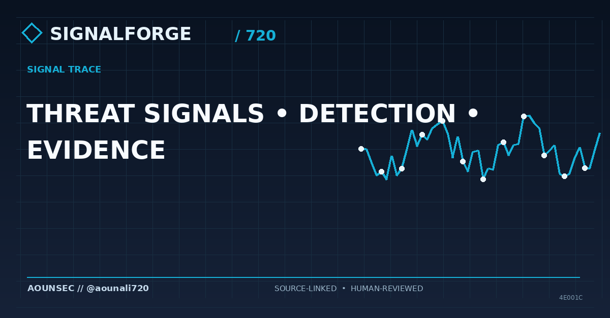
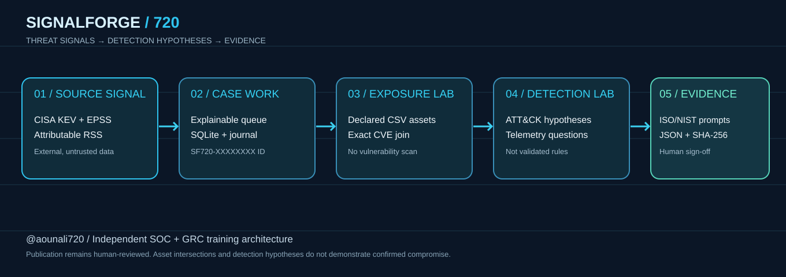

# SIGNALFORGE 720 // Threat → Detection → Evidence

**A personalized blue-team portfolio lab by [@aounali720](https://github.com/aounali720).**



[](https://www.python.org/)   

> **Purpose:** an independent, single-user *learning system*. It does not prove that an organization is compromised, validate vulnerable asset versions, certify ISO/NIST compliance, or replace vendor advisories. Scoring is an explainable exercise, **not CVSS**. The lab is fictional and always labeled.

## Why I made it

A security news feed is just the beginning of analysis. My objective with **SignalForge 720** was to practice the complete analyst chain: **source → priority → declared asset intersection → telemetry hypothesis → evidence packet → defensible summary**. I built it to demonstrate practical skills for SOC Analyst, junior Detection Engineering, Cloud Security, and GRC roles rather than showing a static dashboard.

The *720* signature connects this project to my open-source identity. Its branded visual cards derive reproducible unique patterns from each headline; the app never depicts fictional screenshots as real incidents.

## What makes it different

| Module | What it actually does | Honest boundary |
| --- | --- | --- |
| **Signal Board** | CISA KEV + publisher RSS intake, FIRST EPSS, source links, interpretable queue | Keywords ≠ verified compromise |
| **Case workbench** | Stable `SF720-XXXXXXXX` case IDs, statuses, analyst journal, persistence | Single-user SQLite; no immutable audit trail |
| **Exposure Lab** | CSV of operator-declared lab assets; exact CVE intersections, review-priority formula | Matches do **not** verify versions or vulnerability |
| **Detection Lab** | ATT&CK-inspired keyword hypotheses, telemetry questions, safe verification exercises, worksheets | Not observed TTPs or production-tested detection rules |
| **Evidence Binder** | Markdown + JSON case files; analyst notes, declared intersections, potential ISO 27001/NIST CSF evidence; SHA-256 checksum | Digest is **not** a signature or certification |
| **Daily brief** | Human-reviewable, primary-source-linked reporting | No automated incident assertions |
| **Content Studio** | Reviewable LinkedIn drafts, optional OpenAI/Claude, reproducible editorial cards | No unattended social publishing; optional API use can cost money |
| **Software practices** | Automated offline tests, CI, Docker, per-feed error handling | Live integrations must be tested in your environment |

### Architecture



Architecture details: [docs/architecture.md](docs/architecture.md)

## Launch on Windows 11

Open PowerShell in a directory containing this project. Python **3.12** is the tested, locked baseline. The app is not packaged into an EXE.

```powershell
py -3.12 -m venv .venv
.\.venv\Scripts\python.exe -m pip install -r requirements.lock
.\.venv\Scripts\python.exe -m streamlit run app.py
```

Open **http://localhost:8501**. Install an official Python 3.12 interpreter if `py -3.12` is unavailable.

> On Windows with App Control policies blocking binary extensions, a fresh venv with an approved, official CPython version may be necessary. Do not disable system security controls to run the project.

### Signature 720 demo — completely offline

1. In the sidebar, click **Load 720 signature lab** (4 fictional cases, 3 fictional assets).
2. **Signal Board:** inspect the calculated queue. Demo records are prominently flagged.
3. **Exposure Lab:** examine the intersections for fictional `CVE-2099-0001` and `CVE-2099-0002` with invented lab systems. These identifiers are **not real vulnerability claims**.
4. **Detection Lab:** open a synthetic ransomware or phishing case. Export the ATT&CK-*inspired* validation worksheet.
5. **Evidence Binder:** select a case, add an analyst note on the workbench, and export Markdown + JSON. Verify the SHA-256 checksum as a data-integrity exercise.
6. **Content Studio:** generate a template draft and a deterministic, individualized editorial graphic. A synthetic draft must never be described as breaking news.

Illustrative [inventory CSV](assets/example-inventory.csv), [synthetic example case](docs/example-synthetic-case.md), [guided demo](docs/demo-walkthrough.md), and [portfolio kit](docs/portfolio-kit.md) included.

### Go from training to live public intelligence

Click **Sync live sources** in the sidebar. Public information is retrieved from the [CISA KEV catalog](https://www.cisa.gov/known-exploited-vulnerabilities-catalog), [FIRST EPSS](https://www.first.org/epss/) (when enabled), and short RSS excerpts from attributed cybersecurity publishers. Review source links. The tool never scans a target host or claims it has detected live exploitation.

**Asset privacy:** do not import private enterprise inventories into a public demo or commit `data/`, `.env`, or exported case files that contain sensitive notes. Import CSV is capped at 500 assets/1 MB. All vulnerability-to-asset links come from the **operator's declared CVE IDs**, not fingerprinting or internet scans.

### CLI

```powershell
.\.venv\Scripts\python.exe -m signalforge.cli demo
.\.venv\Scripts\python.exe -m signalforge.cli stats
.\.venv\Scripts\python.exe -m signalforge.cli case --key demo:2 --output reports/demo-case.md
.\.venv\Scripts\python.exe -m signalforge.cli brief --brief-days 3 --output reports/public-brief.md
.\.venv\Scripts\python.exe -m pytest -q
```

Other commands: `sync --days 45` for public data; `case --format json --output reports/case.json` for a structured packet. `brief` intentionally excludes synthetic records by default. CI tests are in `.github/workflows/ci.yml`, and an optional scheduled public-source brief is in `.github/workflows/daily-brief.yml`.

### Optional writing models

Copy `.env.example` to `.env` and set **either** `OPENAI_API_KEY` **or** `ANTHROPIC_API_KEY`; these are used for optional content drafting only. Change model names as availability changes, and do not commit secrets. All external draft content must be checked manually; text is not automatically posted. The offline content template and branded graphics require no paid model.

### Linux/macOS

```bash
python3.12 -m venv .venv
source .venv/bin/activate
python -m pip install -r requirements.lock
streamlit run app.py
```

Docker: `docker compose up --build` — local-only `127.0.0.1:8501` port mapping. No authentication is implemented; don't expose publicly.

## Explainable scoring, not risk certification

The base advisory heuristic assigns KEV +70, CISA-known ransomware +12, EPSS up to +18, or one strongest non-KEV headline term (up to +24) plus CVE mention (+6). The lab asset review score is `round(0.65 × advisory priority) + 15 when internet-exposed + 5/12/20 for low/medium/high declared criticality` (capped at 100). Scores are for **review order only**.

A fictional CVE in an exercise is not a real advisory. An exact match against operator-supplied CVE strings is not equivalent to proof that a particular asset version is vulnerable. Suggested NIST/ISO references are discussion prompts, not an assessment result.

## Project map

```text
app.py                          Streamlit workbench with 8 modules
signalforge/
  sources.py                    CISA, EPSS, attributed RSS collection
  prioritize.py                 Interpretable metadata heuristic
  database.py                   Local SQLite cases and notes
  exposure.py                   Invented/declared assets + CVE intersection
  detection.py                  Candidate ATT&CK technique + telemetry worksheets
  evidence.py                   Integrity-checkable case packets
  reports.py                    Daily brief and offline LinkedIn draft
  ai.py / image_ai.py           Optional paid models
  covers.py                     Headline-seeded 720 visual identity
  demo.py / cli.py              Offline simulations and command-line tools
assets/example-inventory.csv    Explicitly fictional lab inventory
assets/architecture.svg         Data-flow drawing
docs/                           Architecture, walkthrough, CV and LinkedIn material
tests/                          Offline automated tests
.github/workflows/              CI and optional scheduled source briefing
```

**Ethical use:** Independently developed; no endorsement by CISA, FIRST, ISO, NIST, MITRE, or source publishers. Observe API/feed conditions. Names of products, vulnerabilities and adversary techniques in training material are learning prompts only. MIT License; see [SECURITY.md](SECURITY.md).

## Development and maintenance

Use Python 3.12 and install `python -m pip install -r requirements-dev.lock`.
Run `python -m pytest -q`, `python -m ruff check --select E9,F63,F7,F82 .`, and
`python -m pip check`. Tests are offline and include Streamlit interactions with a temporary database.
The reviewed snapshot has 36 tests; see [review notes](docs/review-notes.md) for changes and verification limits.

`requirements.txt` and `requirements-dev.txt` express supported dependency ranges;
`requirements.lock` and `requirements-dev.lock` pin the resolved Python 3.12 environment.
Docker and CI use the locks. For a dependency update, resolve the range files in a clean
Python 3.12 environment, regenerate both lock files (keeping runtime packages separate from
pytest/ruff), inspect the diff, run tests, and audit the resulting runtime lock.
Do not generate locks from an environment containing unrelated tooling.
For the audit, install `pip-audit==2.10.0` in a separate tooling environment and run
`python -m pip_audit -r requirements.lock`. Exact pins improve repeatability; they are
not artifact hashes or a guarantee against future vulnerabilities.

The scheduled public-source workflow produces a downloadable, seven-day artifact and
never commits data or publishes to social media. It runs without paid API credentials.
Feed failures are reported separately; a successful partial sync is not proof that every feed worked.
CI uses read-only repository permissions and pinned action revisions.

Local `.env`, SQLite files, private inventories, and newly generated reports are ignored by
Git and excluded from Docker builds. The two tracked `reports/demo-case.*` files contain
fictional examples only. Review `git status` and staged diffs before pushing; ignore rules
do not protect files already tracked or files placed in arbitrary locations.
